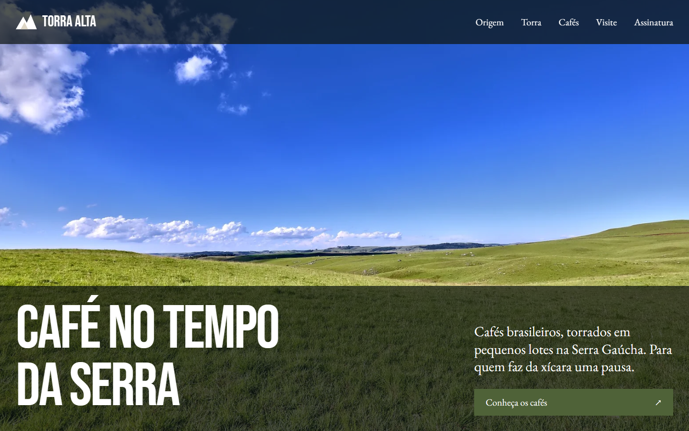

# Torra Alta

Café especial no tempo da Serra Gaúcha: uma experiência editorial sobre origem, torra e pequenos rituais.

**Projeto de portfolio, marca ficticia.** Criado por [Eduardo Nitz · DadoNitz](https://github.com/DadoNitz). Torra Alta, identidade, embalagens, cafés e operação comercial foram criados para este projeto; não representam uma empresa existente.



## Stack

HTML semântico, CSS responsivo e JavaScript puro. Sem framework, instalação, build obrigatório ou dependências de runtime. Fontes, fotografias e vídeo ficam no próprio projeto.

## O que este projeto demonstra

- Direção visual autoral com fotografia ampla, tipografia condensada e uma paleta de areia e musgo. Embalagens desenhadas em CSS, sem mockups de terceiros.
- Narrativa de torra ligada ao scroll nativo: aquecer, resfriar e descansar. As imagens se cruzam suavemente; o usuário pode voltar a qualquer momento.
- Molas criticamente amortecidas no press, preservando posição e velocidade ao interromper. Entradas discretas com a Web Animations API e Intersection Observer.
- Vídeo documental de resfriamento, sem áudio, com pausa manual. Para ao sair da cena, ocultar a aba ou ativar movimento reduzido.
- Cards com origem, processo, notas sensoriais e preços. A escolha do café segue para uma simulação de assinatura com quantidade e moagem.
- Foco visível, link para pular a navegação, controles nativos de teclado, textos alternativos e resumo anunciado por tecnologia assistiva. O processo completo tem transcrição acessível.
- `prefers-reduced-motion` troca a cena fixa por uma sequência estática. Sem JavaScript, o conteúdo continua disponível e a simulação fica desabilitada.
- WebP com versões específicas para celular, carregamento adiado e fontes WOFF2 locais sob SIL Open Font License.

## Rodar localmente

Abra `index.html` diretamente, ou sirva a pasta com Python 3:

```sh
python -m http.server 4173
```

Acesse **http://localhost:4173**. Não há variáveis de ambiente ou credenciais.

Para conferir o cálculo dos planos, use Node.js 24 ou superior:

```sh
node --test tests/subscription.test.cjs
```

## GitHub Pages

O workflow [pages.yml](.github/workflows/pages.yml) testa os planos, empacota somente os arquivos estáticos e usa as actions oficiais `configure-pages`, `upload-pages-artifact` e `deploy-pages`. Todos os caminhos internos são relativos, compatíveis com publicação em uma subpasta de repositório.

Quando você decidir publicar o repositório, selecione **Settings → Pages → Source → GitHub Actions**. O workflow responde a commits na branch `main` e também permite execução manual. Configuração baseada na [documentação oficial de workflows do GitHub Pages](https://docs.github.com/en/pages/getting-started-with-github-pages/using-custom-workflows-with-github-pages).

Nenhum repositório remoto foi criado e nenhum push ou deploy foi executado durante a construção.

## Validação

Screenshots revisados em **1440, 768 e 390 px**, incluindo a página inteira. Tasteskill: **0 FAIL**, com um aviso de quantidade de tamanhos tipográficos justificado em [docs/validation.md](docs/validation.md). A cena foi capturada de 0 a 100% em desktop e celular, além da versão com movimento reduzido.

Testados em Chrome headless: navegação e foco por teclado, escolha de café, troca de plano por setas, envio da simulação com Enter, pausa do vídeo, reversão do scroll, ausência de JavaScript e abertura por `file://`. O preview deste README foi gerado em Chrome headless a 1440 × 900.

Lighthouse mobile final: **100 performance · 100 acessibilidade · 100 boas práticas · 100 SEO**, em servidor local. Métricas e limites da validação estão registrados em [docs/validation.md](docs/validation.md). Não houve teste em Safari, Firefox, leitor de tela real ou celular físico, nem validação do workflow em um repositório remoto.

## Direção e conteúdo

O conceito é **“subir para desacelerar”**. A direção `The place carries it`, seed `419834393`, veio do tasteskill; o projeto aplica resposta ao press, molas interrompíveis, tipografia e movimento reduzido do apple-design. O argumento e as escolhas visuais estão em [docs/design.md](docs/design.md).

Preços, planos, disponibilidade, cafés, localização comercial e horários são conteúdo fictício. A assinatura é uma simulação local: não envia dados, não cobra e não reserva produtos. Fotografias documentais mostram paisagens, materiais e rituais reais, sem representar instalações ou produtos próprios da marca.

## Créditos das fotografias e vídeo

Todas as mídias foram encontradas e baixadas pelo `assets.mjs` do tasteskill, com licenças que permitem reutilização comercial. Os créditos também estão disponíveis no rodapé da página e em [assets/credits.json](assets/credits.json).

| Uso | Obra e fonte | Autor | Licença |
| --- | --- | --- | --- |
| Hero | [Campos do Parque estadual do Tainhas](https://commons.wikimedia.org/wiki/File:Campos_do_Parque_estadual_do_Tainhas.jpg) | Rodrigo Alexandre Geyer Kaspary | [CC BY-SA 3.0](https://creativecommons.org/licenses/by-sa/3.0/) |
| Origem | [Pedra dos Três Pontos ES 01](https://commons.wikimedia.org/w/index.php?curid=117677306) | Martin Thurnherr | [CC BY-SA 4.0](https://creativecommons.org/licenses/by-sa/4.0/) |
| Aquecer | [Roasted coffee beans on the surface. 01](https://commons.wikimedia.org/wiki/File:Roasted_coffee_beans_on_the_surface._01.jpg) | A S M Jobaer | [CC BY-SA 4.0](https://creativecommons.org/licenses/by-sa/4.0/) |
| Descansar e cafeteria | [Manual drip (pour-over) coffee](https://commons.wikimedia.org/w/index.php?curid=70214599) | Kim Sanso | [CC0](https://creativecommons.org/publicdomain/zero/1.0/) |
| Fechamento | [Curvas sinuosas e paredões de formação em basalto do Canyon Itaimbezinho e ao fundo o Rio do Boi](https://commons.wikimedia.org/w/index.php?curid=49688708) | Portal dos Canyons | [CC BY-SA 4.0](https://creativecommons.org/licenses/by-sa/4.0/) |
| Resfriar, vídeo e poster | [Kaffe - Ystad-2024](https://commons.wikimedia.org/wiki/File:Kaffe_-_Ystad-2024.ogg) | Foto: Jonn Leffmann | [CC BY 3.0](https://creativecommons.org/licenses/by/3.0/) |

As versões WebP foram redimensionadas e comprimidas; a versão móvel do hero recebeu recorte central. Nenhuma foto recebeu retoque ou recoloração. Os arquivos derivados mantêm as licenças indicadas para seus originais, incluindo o compartilhamento pela mesma licença quando aplicável. Os JPEGs de origem foram preservados. O vídeo foi mantido no formato fornecido pelo acervo, com poster convertido para WebP.

**Tipografia:** Bebas Neue, de Ryoichi Tsunekawa, e EB Garamond, de Georg Duffner e colaboradores, distribuídas pelo Google Fonts. Licenças locais: [Bebas Neue OFL](assets/fonts/bebas-neue-OFL.txt) e [EB Garamond OFL](assets/fonts/eb-garamond-OFL.txt). Símbolo, composição e embalagens são desenhos originais deste projeto. Nenhuma imagem foi gerada por IA e o Higgsfield não foi utilizado.
